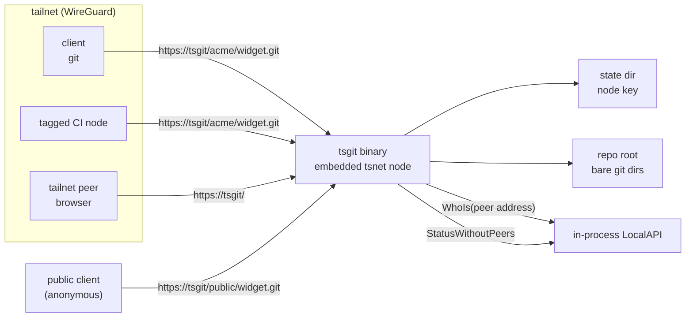

# Architecture

## Shape

A single binary, `tsgit`, that owns an embedded `tsnet` node. It joins the
tailnet as its own machine, binds listeners inside the tailnet, and serves git
smart HTTP. There is no host Tailscale dependency, no root, no separate TLS
termination, and no account database.

This slice serves HTTP only. SSH is deferred to a later front end; smart HTTP
already carries clone, fetch, and push. A Funnel front end is an optional,
read-only add-on: it is off unless the deployment opts in, and it never replaces
the tailnet listener.



## Identity comes from the embedded node, never from the client

Every accepted request is resolved through the embedded node's LocalAPI before
any authorization decision:

```
tsnet.Server.LocalClient().WhoIs(ctx, r.RemoteAddr)
```

The response supplies the node, an optional user profile, the node's ACL tags,
and the peer capability map. `tsgit` turns that into an `authz.Identity`:
node id, optional login, tags, and decoded repository grants.

Only the peer address is used. HTTP headers such as `X-Forwarded-For` and
`Tailscale-User-Login` are never read as identity, nor is a query parameter or
request body. A client cannot choose who it is.

Tagged nodes are first-class. A node with `tag:ci` but no user login resolves
successfully, and its capability authorizes access. Authorization never depends
on a login existing. If the lookup fails, the request is refused with a logged
503; there is no permissive fallback and no assumed identity.

## Authorization is a value-level decision

`internal/authz` takes an identity, a canonical `<namespace>/<repo>` name, and
an operation. It returns a decision. It does not import `net/http`, tsnet, or a
connection type, so it is tested without a tailnet.

The capability is `github.com/kevindurb/tsgit/cap/repo`. Grants union, the
highest level wins, `write` implies `read`, `write` authorizes creation, and
`admin` implies `write` and authorizes deletion. No matching pattern denies.
The public Funnel principal is always read-only, so it can never hold `admin`.
The full payload contract is in `docs/access-control.md`.

The handler decides before it resolves a repository for creation and before it
starts a backend process. A denied push can therefore never create a directory
or spawn git.

## Layers

| Layer | Responsibility | Depends on |
|---|---|---|
| `cmd/tsgit` | Commands, config load, tsnet node, listeners, shutdown | `internal/*` |
| `internal/config` | Flags, environment fallbacks, validation, dev root | stdlib, `ipn` |
| `internal/identity` | Resolve a peer address, or the public node capability, to an `authz.Identity` | LocalAPI, `tailcfg` |
| `internal/authz` | Pure read/write/create/delete decision | stdlib only |
| `internal/repos` | Canonical names, containment, metadata reads, atomic creation and deletion | a root directory, `git` |
| `internal/transport` | Smart-HTTP routing and framing, backend seam | `identity`, `authz`, `repos` |
| `internal/web` | Read-only discovery pages plus the admin deletion handler | `identity`, `authz`, `repos` |

Dependency arrows point one way. `transport` and `web` are the only layers that
know about a network request; `identity` is the only layer that knows about
Tailscale.

## HTTP surface

The tailnet listener serves three surfaces: git smart HTTP, discovery, and
deletion. The git handler serves exactly four smart-HTTP endpoints:

| Method | Path | Operation |
|---|---|---|
| GET | `/<ns>/<repo>.git/info/refs?service=git-upload-pack` | read |
| GET | `/<ns>/<repo>.git/info/refs?service=git-receive-pack` | write + create |
| POST | `/<ns>/<repo>.git/git-upload-pack` | read |
| POST | `/<ns>/<repo>.git/git-receive-pack` | write + create |

A request the git handler does not recognize is not refused by the system; it is
routed to the deletion handler when it targets `/.tsgit/delete/`, and to the
discovery front end otherwise. No git backend starts. Dispatch calls the git
handler's own route parser, so a malformed smart-HTTP request is not treated as
a repository summary; it receives the same not-found response as any other
unknown path.

The request pipeline is: resolve identity, parse the route into name/service/
operation, decide access, resolve the repository (creating it on an authorized
receive-pack when missing), then hand the exchange to the backend.

Status codes are deliberate:

- `404` for a denied repository, a missing repository, and an unsupported
  method, service, or path. A denied request and a missing one are
  indistinguishable, so the response is not an existence oracle. The distinct
  reason is logged server-side.
- `503` when identity resolution fails.
- `500` when repository creation fails or the backend fails before any response
  byte is written. Once bytes are streaming, a backend failure is logged and the
  response cannot change status.
- `400` for a malformed gzip request body.

### Discovery surface

The tailnet and public listeners serve a read-only HTML front end:

| Method | Path | Page |
|---|---|---|
| GET | `/` | repository index |
| GET | `/<ns>/<repo>` | repository summary |
| GET | `/<ns>/<repo>.git` | redirect to the summary |
| GET | `/.tsgit/web.css`, `/.tsgit/favicon.svg` | embedded assets |

The index resolves the viewer through the same `WhoIs` path as git, filters the
repository list with `authz.Decide(id, name, OpRead)`, and marks whether the
viewer may push. The summary makes the same read decision and returns the same
`404` for a denied repository and a missing one. A mutating method is `405`; an
identity lookup failure is a logged `503`.

Metadata comes from `internal/repos`: the `description` file, `HEAD`, and one
read-only `git for-each-ref` per repository for the latest commit and ref
counts. Each git call is bounded by a timeout, and one unreadable repository
degrades to a name-only row instead of failing the page.

Pages are self-contained: `html/template` and `go:embed`, no JavaScript, no
external assets, and a restrictive content security policy. Light and dark
rendering follow `prefers-color-scheme`. HTML is served with `no-store` because
the index is filtered per identity; the CSS and SVG use an `ETag`.

Framing follows git's smart HTTP rules. For v0/v1 reference discovery the
handler writes the `# service=git-upload-pack` (or `receive-pack`) pkt-line and
a flush packet before the advertisement. With `Git-Protocol: version=2` the
service line is omitted for upload-pack; receive-pack keeps the v0 line and
falls back. Content types are
`application/x-git-<service>-advertisement` and
`application/x-git-<service>-result`, with no-cache headers. Request bodies are
streamed, gzip request bodies are inflated, and responses are flushed as the
backend writes rather than buffered.

### Deletion surface

The tailnet listener serves an admin-only deletion page under the reserved
`/.tsgit/` prefix:

| Method | Path | Page |
|---|---|---|
| GET | `/.tsgit/delete/<ns>/<repo>` | confirmation |
| POST | `/.tsgit/delete/<ns>/<repo>` | delete the repository |

The handler is separate from discovery. It resolves the viewer through the same
`WhoIs` path, requires `authz.Decide(id, name, OpDelete)` to allow, and returns
the same `404` for a denied repository and a missing one. The confirmation page
requires the canonical name to be typed. The `POST` carries a token signed over
the peer node, repository, action, and a short expiry; a missing, altered, or
expired token is `403`. An `Origin` or `Sec-Fetch-Site` header that names
another origin is also `403`. There is no cookie, session, or server-side token
store. A successful `POST` is a `303` redirect to the index.

The Funnel composition does not mount the deletion handler, so the route is a
structural `404` on the public listener. `cmd/tsgit` generates the signing key
once at startup and passes it to the handler; a failure to read the system
CSPRNG fails startup rather than silently disabling deletion.

### Public front end (Funnel)

With `--funnel`, the daemon opens a second listener with
`tsnet.Server.ListenFunnel(":443", tsnet.FunnelOnly())` alongside the tailnet TLS
listener. tsnet dispatches by flow origin, so this is a trust boundary rather
than a runtime classification: the tailnet handler never sees a public
connection, and the public handler never sees a tailnet peer. The same port is
allowed because the Funnel listener is registered as Funnel-only. Funnel accepts
ports 443, 8443, and 10000; `--port` must therefore be one of them.

The Funnel listener must be opted into three times: `--funnel`, the tailnet
`funnel` node attribute, and a non-empty `github.com/kevindurb/tsgit/cap/funnel`
payload under `nodeAttrs.app`. If a prerequisite is missing or the listener
cannot bind, the daemon logs an error and keeps serving only the tailnet.

The public handler is a separate composition:

| Concern | Tailnet path | Public path |
|---|---|---|
| Identity | `WhoIs(r.RemoteAddr)` | node `cap/funnel` via `StatusWithoutPeers` |
| Principal | peer node, login, tags, grants | synthetic `funnel`, read-only grants |
| Services | upload-pack, receive-pack | upload-pack only |
| Discovery | viewer's authorized view | public subset, no write affordances |
| Limits | header timeout | header/read/idle timeouts, 1 MiB headers, 64 MiB bodies, 4 concurrent packs |

Public requests never call `WhoIs`. The client address is taken from
`FunnelConn.Src` for access logs only; `Conn.RemoteAddr` is the Funnel relay and
is never used for authorization. A failed status lookup is refused with a logged
`503`.

Both HTTP servers run under one shutdown path. `runServers` starts each server,
then on cancellation or the first failure shuts all of them down and waits for
in-flight requests, for up to ten seconds. The tailnet server is unaffected by a
public listener failure, and a public request in flight is allowed to drain.

### Replaceable backend

The handler never invokes git directly:

```go
type Request struct {
    RepoPath    string
    Service     string
    GitProtocol string
    Advertise   bool
    Stateless   bool
    Body        io.Reader
    Out         io.Writer
}

type Backend interface {
    Serve(ctx context.Context, req Request) error
}
```

The first backend, `GitBin`, execs
`git upload-pack` or `git receive-pack` with `--stateless-rpc`, adding
`--advertise-refs` for discovery and setting `GIT_PROTOCOL` from the request
header, streaming stdin and stdout and logging stderr. A pure-Go backend can
replace it without touching identity, authorization, routing, or repository
resolution. ADR 0001 still governs the default; ADR 0002 records why the seam
exists and when a replacement becomes attractive.

## Storage

Two trees, separate on purpose:

```
$TSGIT_STATE_DIR/               0700, node key and tsnet state
  tailscaled.state

$TSGIT_REPO_ROOT/               0750, the durable artifact
  .tsgit-tmp/                   staging on the same filesystem
  acme/
    widget.git/                 a normal bare git directory
      HEAD                      -> ref: refs/heads/main
      description               git's own file
      objects/
      refs/
```

The state directory is a secret tied to this node and is not part of repository
backups. The repository root is plain bare git directories, inspectable with
`ls` and backed up with `rsync`. There is no database and no custom metadata
store; git's own files are the metadata.

Creation is atomic:

1. Validate both segments syntactically.
2. Ensure the namespace directory exists and still resolves inside the root.
3. Create a staging directory under `.tsgit-tmp`.
4. Run `git init --bare --initial-branch=<default>` inside it.
5. Rename the finished bare directory into place. If a concurrent creator won,
   use the existing repository and remove the staging copy.
6. Readers never see a half-initialized repository.

Deletion uses the same lock and the staging directory:

1. Validate and resolve the name.
2. Lock the store and re-check that the directory exists and is not a symlink.
3. Rename the bare directory into `.tsgit-tmp/delete-*`.
4. Release the lock and remove that copy.

The rename is the moment the repository disappears. A reader sees either the
complete repository or a not-found result, never a partially deleted tree. A
clone or push already in flight keeps its open inode and can finish; a request
that starts after the rename gets not-found. A namespace directory left empty is
removed best-effort. The shared lock serializes creation and deletion so a name
cannot be created or removed between another operation's existence check and its
rename.

Every name is resolved under the root and checked again through any existing
symlink. `..`, absolute paths, hidden names, control characters, and symlinks
that leave the root are refused.

## Configuration, HTTPS, and shutdown

Flags and environment fallbacks are documented in `docs/configuration.md`. The
daemon sets `hostinfo.SetApp("tsgit")`, starts the embedded node with the
configured hostname, state, auth key, tags, and control URL, then listens only
on the tailnet.

HTTPS is used only when `--https` is set, the node advertises the `https`
capability, and the tailnet returns a certificate domain. Otherwise the daemon
serves plain HTTP and logs why. The HTTPS path serves TLS on `--port`, redirects
HTTP on `--http-port`, and adds HSTS.

Shutdown is `signal.NotifyContext` plus `http.Server.Shutdown` for every
listener, then `tsnet.Server.Close`. In-flight requests are allowed to drain for
up to ten seconds.

## Deferred

SSH transport, running against a host `tailscaled`, Tailscale Service mode, code
browsing in the web UI (trees, blobs, diffs, README rendering), ref-level
permissions, public write or public accounts, audience control over public
repositories, and a go-git backend are out of scope for this slice. Each is a
separate front end, trust boundary, or measured replacement decision.
