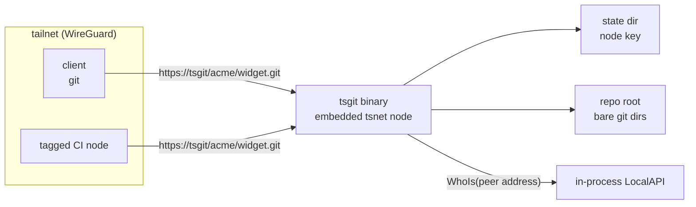

# Architecture

## Shape

A single binary, `tsgit`, that owns an embedded `tsnet` node. It joins the
tailnet as its own machine, binds listeners inside the tailnet, and serves git
smart HTTP. There is no host Tailscale dependency, no root, no separate TLS
termination, and no account database.

This slice serves HTTP only. SSH is deferred to a later front end; smart HTTP
already carries clone, fetch, and push.



## Identity comes from the embedded node, never from the client

Every accepted request is resolved through the embedded node's LocalAPI before
any authorization decision:

```
tsnet.Server.LocalClient().WhoIs(ctx, r.RemoteAddr)
```

The response supplies the node, an optional user profile, the node's ACL tags,
and the peer capability map. `tsgit` turns that into an `authz.Identity`:
node id, optional login, tags, and decoded repository grants.

Only the peer address is used. HTTP headers such as `X-Forwarded-For` and
`Tailscale-User-Login` are never read as identity, nor is a query parameter or
request body. A client cannot choose who it is.

Tagged nodes are first-class. A node with `tag:ci` but no user login resolves
successfully, and its capability authorizes access. Authorization never depends
on a login existing. If the lookup fails, the request is refused with a logged
503; there is no permissive fallback and no assumed identity.

## Authorization is a value-level decision

`internal/authz` takes an identity, a canonical `<namespace>/<repo>` name, and
an operation. It returns a decision. It does not import `net/http`, tsnet, or a
connection type, so it is tested without a tailnet.

The capability is `github.com/kevindurb/tsgit/cap/repo`. Grants union, the
highest level wins, `write` implies `read`, `write` also authorizes creation,
and no matching pattern denies. The full payload contract is in
`docs/access-control.md`.

The handler decides before it resolves a repository for creation and before it
starts a backend process. A denied push can therefore never create a directory
or spawn git.

## Layers

| Layer | Responsibility | Depends on |
|---|---|---|
| `cmd/tsgit` | Commands, config load, tsnet node, listeners, shutdown | `internal/*` |
| `internal/config` | Flags, environment fallbacks, validation, dev root | stdlib, `ipn` |
| `internal/identity` | Resolve a peer address to an `authz.Identity` | LocalAPI, `tailcfg` |
| `internal/authz` | Pure read/write/create decision | stdlib only |
| `internal/repos` | Canonical names, containment, atomic creation | a root directory, `git` |
| `internal/transport` | Smart-HTTP routing and framing, backend seam | `identity`, `authz`, `repos` |

Dependency arrows point one way. `transport` is the only layer that knows about
a network request; `identity` is the only layer that knows about Tailscale.

## HTTP surface

The handler serves exactly four smart-HTTP endpoints:

| Method | Path | Operation |
|---|---|---|
| GET | `/<ns>/<repo>.git/info/refs?service=git-upload-pack` | read |
| GET | `/<ns>/<repo>.git/info/refs?service=git-receive-pack` | write + create |
| POST | `/<ns>/<repo>.git/git-upload-pack` | read |
| POST | `/<ns>/<repo>.git/git-receive-pack` | write + create |

Everything else is refused before a backend starts.

The request pipeline is: resolve identity, parse the route into name/service/
operation, decide access, resolve the repository (creating it on an authorized
receive-pack when missing), then hand the exchange to the backend.

Status codes are deliberate:

- `404` for a denied repository, a missing repository, and an unsupported
  method, service, or path. A denied request and a missing one are
  indistinguishable, so the response is not an existence oracle. The distinct
  reason is logged server-side.
- `503` when identity resolution fails.
- `500` when repository creation fails or the backend fails before any response
  byte is written. Once bytes are streaming, a backend failure is logged and the
  response cannot change status.
- `400` for a malformed gzip request body.

Framing follows git's smart HTTP rules. For v0/v1 reference discovery the
handler writes the `# service=git-upload-pack` (or `receive-pack`) pkt-line and
a flush packet before the advertisement. With `Git-Protocol: version=2` the
service line is omitted for upload-pack; receive-pack keeps the v0 line and
falls back. Content types are
`application/x-git-<service>-advertisement` and
`application/x-git-<service>-result`, with no-cache headers. Request bodies are
streamed, gzip request bodies are inflated, and responses are flushed as the
backend writes rather than buffered.

### Replaceable backend

The handler never invokes git directly:

```go
type Request struct {
    RepoPath    string
    Service     string
    GitProtocol string
    Advertise   bool
    Stateless   bool
    Body        io.Reader
    Out         io.Writer
}

type Backend interface {
    Serve(ctx context.Context, req Request) error
}
```

The first backend, `GitBin`, execs
`git upload-pack` or `git receive-pack` with `--stateless-rpc`, adding
`--advertise-refs` for discovery and setting `GIT_PROTOCOL` from the request
header, streaming stdin and stdout and logging stderr. A pure-Go backend can
replace it without touching identity, authorization, routing, or repository
resolution. ADR 0001 still governs the default; ADR 0002 records why the seam
exists and when a replacement becomes attractive.

## Storage

Two trees, separate on purpose:

```
$TSGIT_STATE_DIR/               0700, node key and tsnet state
  tailscaled.state

$TSGIT_REPO_ROOT/               0750, the durable artifact
  .tsgit-tmp/                   staging on the same filesystem
  acme/
    widget.git/                 a normal bare git directory
      HEAD                      -> ref: refs/heads/main
      description               git's own file
      objects/
      refs/
```

The state directory is a secret tied to this node and is not part of repository
backups. The repository root is plain bare git directories, inspectable with
`ls` and backed up with `rsync`. There is no database and no custom metadata
store; git's own files are the metadata.

Creation is atomic:

1. Validate both segments syntactically.
2. Ensure the namespace directory exists and still resolves inside the root.
3. Create a staging directory under `.tsgit-tmp`.
4. Run `git init --bare --initial-branch=<default>` inside it.
5. Rename the finished bare directory into place. If a concurrent creator won,
   use the existing repository and remove the staging copy.
6. Readers never see a half-initialized repository.

Every name is resolved under the root and checked again through any existing
symlink. `..`, absolute paths, hidden names, control characters, and symlinks
that leave the root are refused.

## Configuration, HTTPS, and shutdown

Flags and environment fallbacks are documented in `docs/configuration.md`. The
daemon sets `hostinfo.SetApp("tsgit")`, starts the embedded node with the
configured hostname, state, auth key, tags, and control URL, then listens only
on the tailnet.

HTTPS is used only when `--https` is set, the node advertises the `https`
capability, and the tailnet returns a certificate domain. Otherwise the daemon
serves plain HTTP and logs why. The HTTPS path serves TLS on `--port`, redirects
HTTP on `--http-port`, and adds HSTS.

Shutdown is `signal.NotifyContext` plus `http.Server.Shutdown` for every
listener, then `tsnet.Server.Close`. In-flight requests are allowed to drain for
up to ten seconds.

## Deferred

SSH transport, Tailscale Funnel, Tailscale Service mode, running against a host
`tailscaled`, repository listing and browsing, ref-level permissions, and a
go-git backend are out of scope for this slice. Each is a separate front end,
trust boundary, or measured replacement decision.
