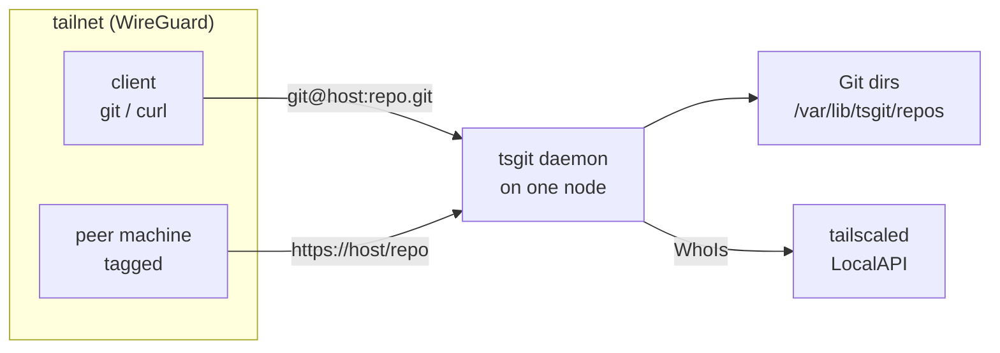
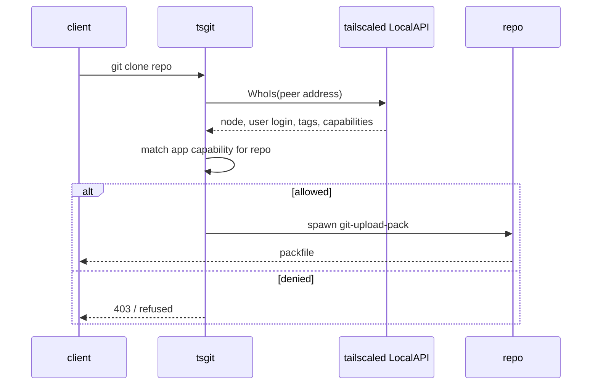

# Architecture

## Shape

A single binary, `tsgit`, running as a systemd unit on one tailnet node. It
exposes two listeners: SSH for git transport, and HTTPS for reads and a small
JSON API. Both bind only to the tailnet interface and are reachable only by
peers the ACL already allows.

## The central decision: identity comes from Tailscale, not from us

Every request arrives from a peer with a known node identity. On the SSH path
the client authenticates to `tailscaled`'s SSH server or to ours, and the user
name carries tailnet identity. On the HTTPS path the client source address maps
to a peer, and `tailscaled`'s LocalAPI `WhoIs` resolves that address to a node,
a user, its tags, and the app capabilities the tailnet grants that peer for
this service.

Authorization is therefore a function of tailnet identity, evaluated per
request. The permission rules themselves live in the tailnet policy file; the
forge stores none of its own.

There is no user table, no session cookie, no password store. The set of
identities that exist *is* the tailnet's node and user list, and it changes
when the tailnet changes.

## Layers

| Layer | Responsibility | Depends on |
|---|---|---|
| `cmd/tsgit` | Flag parsing, config load, listener startup | `internal/*` |
| `internal/identity` | Resolve a connection to a tailnet identity and its capabilities | tailscaled LocalAPI |
| `internal/authz` | Decide read/write for an identity on a repo | capabilities carried by the identity |
| `internal/repos` | Locate, create, and enumerate on-disk repositories | a root directory |
| `internal/transport` | SSH and HTTPS handlers; exec `git` plumbing | `identity`, `authz`, `repos` |

The dependency arrows point one way. `transport` is the only layer that knows
about a network connection; `authz` takes an identity and a repo name and
returns a decision, which makes it testable without a tailnet.

## Storage

Repositories are bare git directories under a single root, named
`<owner>/<repo>.git` where owner is the tailnet user login or a tag. Nothing
else is required: no database, no object store. Metadata that git itself does
not hold — description, default branch, visibility — lives beside the repo in a
small file, so the whole forge is a directory tree that can be backed up with
`rsync` and inspected with `ls`.

## Deployment

One unit file, one config file, one data directory. No external services, so no
compose file and no migration step.
